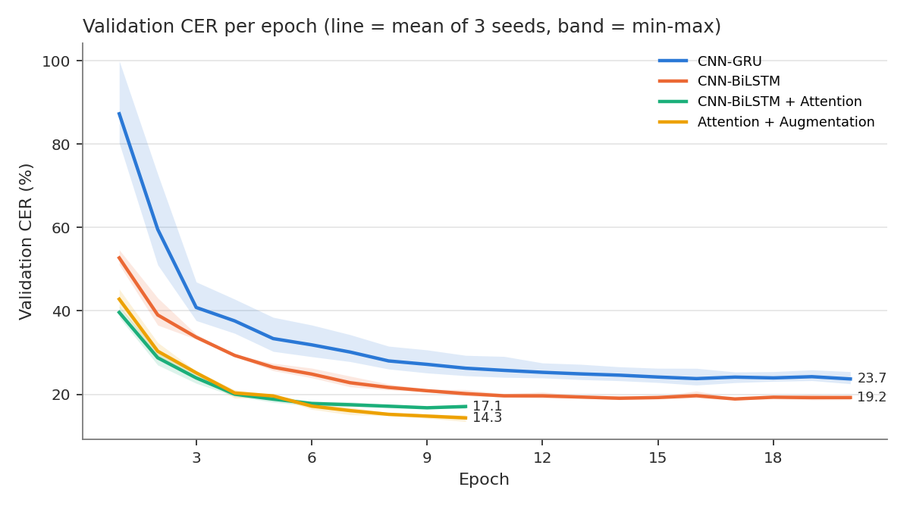
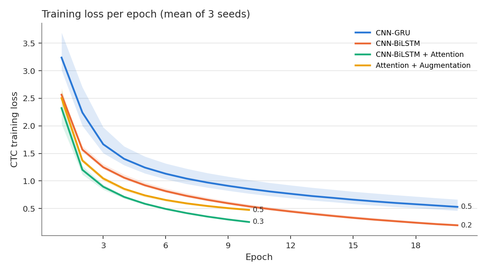
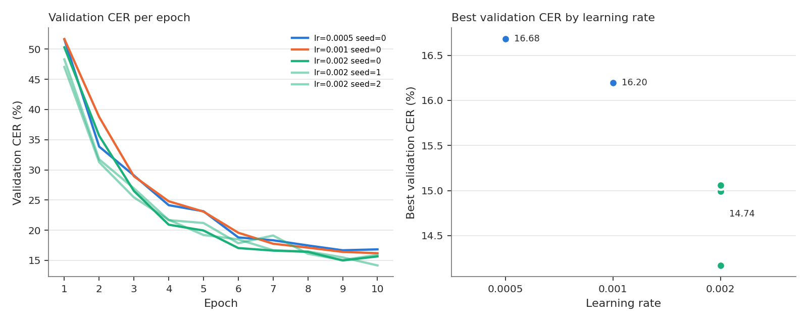
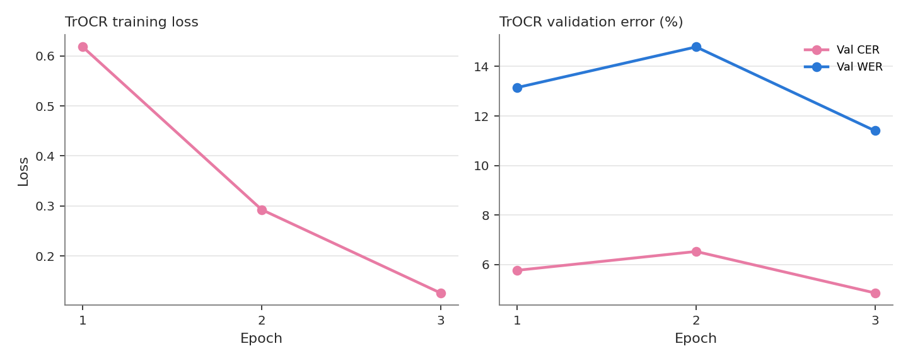
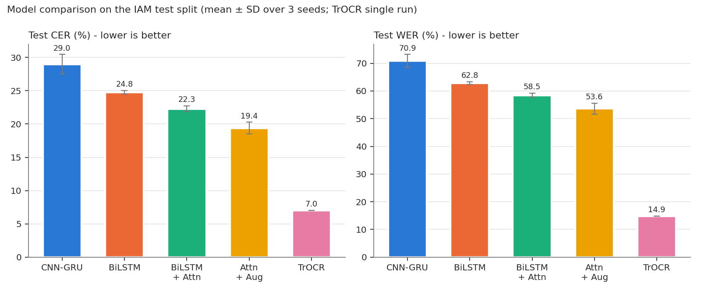
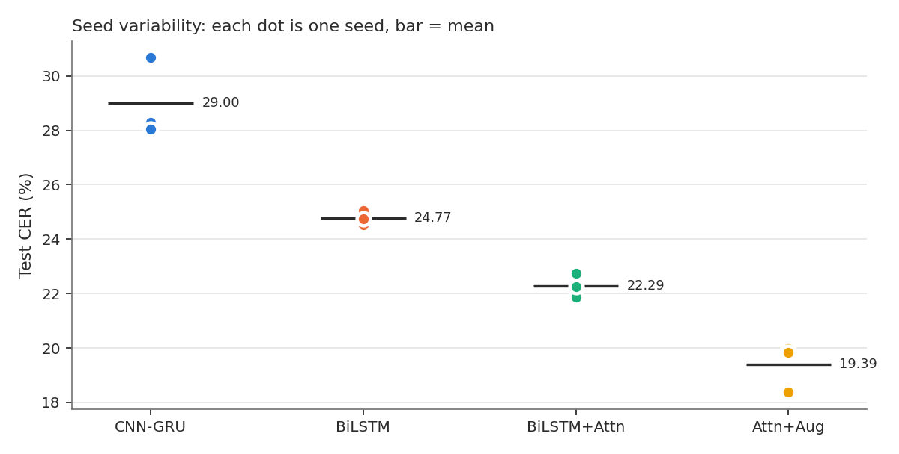
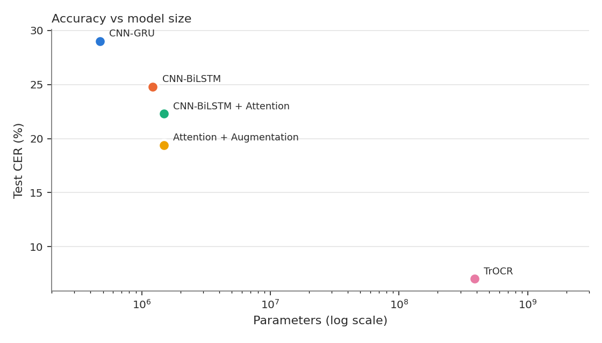
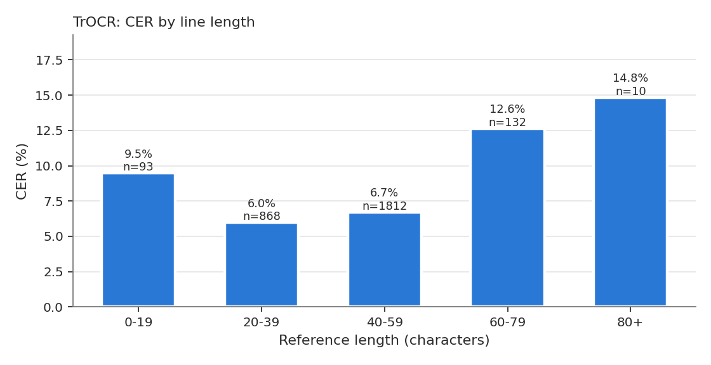
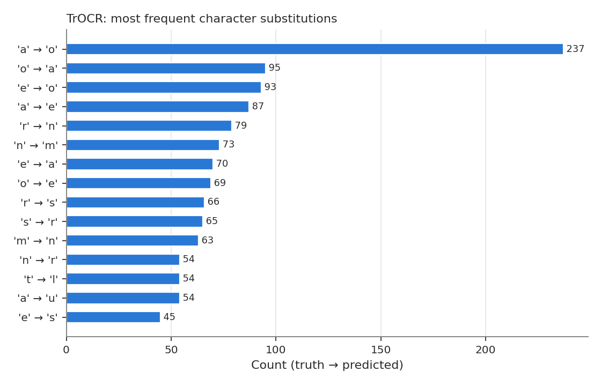
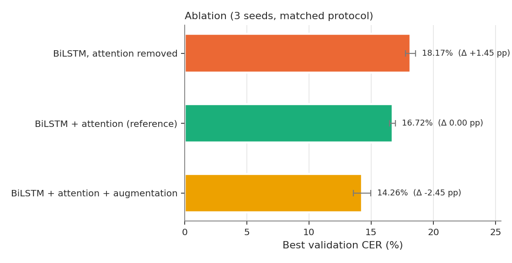

# Experiment results, model comparison, ablation and error analysis

Deliverables 4-7. Every number and graph here is regenerated from the logs in `experiments/` by:

```bash
python -m src.analysis.make_results                                  # tables + graphs
python -m src.analysis.error_analysis --predictions experiments/trocr_test_predictions.json --name trocr --label TrOCR
```

Full tables: [`results/tables/`](../results/tables) · Graphs: [`results/figures/`](../results/figures) · Error analysis: [`results/error_analysis/`](../results/error_analysis)

---

## 4. Experiment results - all runs

Every run (23 total: 12 main CTC, 3 ablation, 5 learning-rate, 2 smoke tests, 1 TrOCR) is listed with its settings, best validation CER and test CER/WER in [`results/tables/all_runs.md`](../results/tables/all_runs.md) (also `.csv`).





### Learning-rate study (attention model, 10 epochs, batch 8)

| Run | LR | Seed | Best val CER |
|---|---:|---:|---:|
| hp_attention_lr0005 | 0.0005 | 0 | 16.68% |
| hp_attention_lr001 | 0.001 | 0 | 16.20% |
| hp_attention_lr002 | 0.002 | 0 | 15.00% |
| hp_attention_lr002_seed1 | 0.002 | 1 | 15.06% |
| hp_attention_lr002_seed2 | 0.002 | 2 | 14.17% |

LR 0.002 gives 14.74 ± 0.48% validation CER over three seeds, the best of the three rates tried.





---

## 5. Model comparison (same protocol: same test split, same metrics, checkpoint chosen on validation CER)

| Model | Runs | Params | Val CER % | Test CER % | Test WER % |
|---|---:|---:|---|---|---|
| CNN-GRU + CTC | 3 | 472K | 23.47 ± 1.66 | 29.00 ± 1.45 | 70.87 ± 2.31 |
| CNN-BiLSTM + CTC | 3 | 1.22M | 18.80 ± 0.23 | 24.77 ± 0.26 | 62.77 ± 0.48 |
| CNN-BiLSTM + Attention + CTC | 3 | 1.48M | 16.72 ± 0.25 | 22.29 ± 0.44 | 58.47 ± 0.72 |
| Attention + Augmentation + CTC | 3 | 1.48M | 14.26 ± 0.71 | 19.39 ± 0.88 | 53.61 ± 1.99 |
| **TrOCR (fine-tuned)** | 1 | 385M | 4.86 | **7.02** | **14.87** |

Mean ± sample standard deviation over seeds 0-2; test split = 2,915 lines; greedy CTC decoding; TrOCR greedy generation (1 beam, 128 tokens).







### Verdict on each hypothesis

| Hypothesis | Evidence | Verdict | Caveat |
|---|---|---|---|
| **H1** - BiLSTM beats the unidirectional CNN-GRU baseline | Test CER 29.00 → 24.77; WER 70.87 → 62.77 | ✅ Supported | Baseline "seed 1" was logged with seed 2 |
| **H2** - Self-attention on top of the BiLSTM improves recognition | Ablation (matched protocol) val CER 18.17 → 16.72; test CER 24.77 → 22.29 | ✅ Supported | Test comparison mixes 20-epoch BiLSTM with 10-epoch attention; the ablation is the fair comparison |
| **H3** - Training-only augmentation improves generalisation | Test CER 22.29 → 19.39; WER 58.47 → 53.61 | ✅ Supported | Gap (2.9 pp) is well above the seed SD (≤ 0.9 pp) |
| **H4** - Fine-tuned pretrained TrOCR beats all custom CTC models | Test CER 7.02 vs best CTC 19.39 | ✅ Supported | One run only; 260× more parameters; not compute-matched |

---

## 6. Error analysis

Full report with examples per failure type: [`results/error_analysis/trocr/ERROR_ANALYSIS.md`](../results/error_analysis/trocr/ERROR_ANALYSIS.md).

**TrOCR, 2,915 test lines:** 1,006 lines (34.5%) are perfect; the median line has 4.3% CER.

| Failure type | Lines | Why it happens |
|---|---:|---|
| 1-2 word confusions (far/for, be/he, at/of) | 1,265 | Similar word shapes; greedy decoding with no external language model |
| Several word errors | 410 | Hard writing styles: heavy slant, cursive ligatures, cramped spacing |
| Punctuation only | 108 | Commas/periods/quotes are a few pixels; IAM's tokenised spacing (`it 's`, `" x "`) must be copied exactly |
| Mostly misread (> 50% words wrong) | 52 | Very hard or faint lines (e.g. #2148, #2742-2746) |
| Case only | 34 | Ambiguous capitals (C/c, S/s, O/o), sentence-initial words |
| Spurious `#` symbol | 28 | Crossed-out words and ink blots read as symbols |
| Spacing only | 11 | Uneven gaps between words |
| Degenerate reference | 1 | Ground truth is only hyphens (#2658) |

Long lines are harder: CER is 6-7% for 20-59 characters but 12.6% for 60-79 and 14.8% for 80+ characters.





**CTC models.** To run the same analysis on a CTC checkpoint (needs GPU/CPU with torch and the dataset):

```bash
python -m src.analysis.predict_ctc --checkpoint checkpoints/attention_aug_seed1.pt --model attention
python -m src.analysis.error_analysis --predictions experiments/attention_aug_seed1_test_predictions.json --name attention_aug_seed1 --label "Attention + Aug"
```

---

## 7. Ablation study

Same protocol for all rows: 10 epochs, batch 4, lr 1e-3, Adam, seeds 0-2, best validation CER.

| Configuration | Change | Val CER % | Val WER % | Δ CER vs reference |
|---|---|---|---|---:|
| BiLSTM, attention removed | − attention | 18.17 ± 0.41 | 53.04 ± 1.08 | +1.45 pp |
| BiLSTM + attention (reference) | - | 16.72 ± 0.25 | 50.29 ± 0.31 | 0.00 |
| BiLSTM + attention + augmentation | + augmentation | 14.26 ± 0.71 | 45.45 ± 1.44 | −2.45 pp |



**Interpretation.**

- Removing the attention block costs 1.45 pp CER and 2.75 pp WER - about 3-6× the seed SD, so the effect is real, not noise. Attention lets each time step look at the whole line, which helps with long-range context (word shapes, spacing) that a single BiLSTM layer captures only partly.
- Adding augmentation gives the largest single gain (−2.45 pp CER). With only 6.5K training lines the models overfit quickly; small rotations, brightness/contrast and noise act as extra writers and make the encoder less sensitive to scan conditions.
- The two effects stack: attention + augmentation is 3.9 pp CER better than the plain BiLSTM under the same budget.

---

## Data-integrity notes

See [`results/tables/data_integrity_notes.md`](../results/tables/data_integrity_notes.md): `baseline_seed1` was run with `--seed 2`, and two augmentation logs predate the `augment` flag being logged. These do not change any conclusion but should be mentioned if asked.
