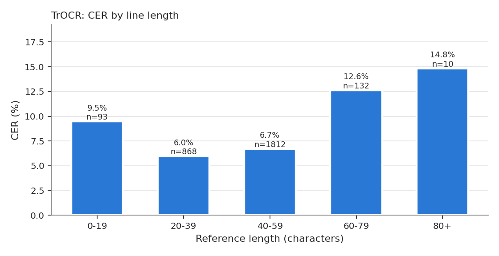
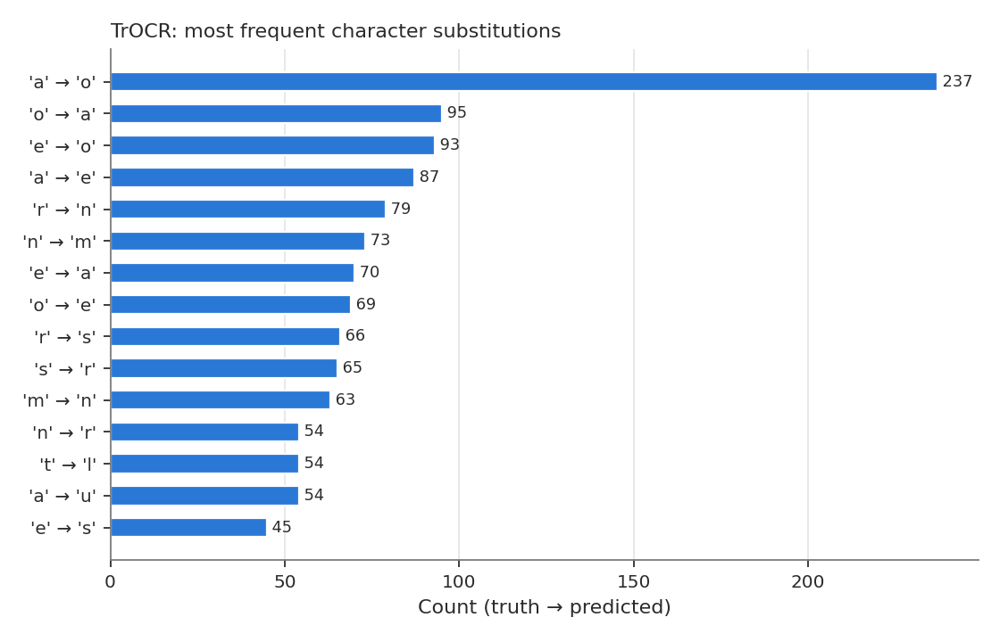
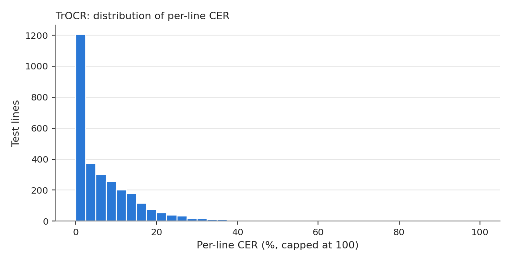

# Error analysis - TrOCR

Source: `experiments/trocr_test_predictions.json` (2915 test lines). Generated by `src/analysis/error_analysis.py`.

## Summary

| Metric | Value |
|---|---|
| Corpus CER | 7.02% |
| Corpus WER | 14.87% |
| Exact line matches | 1006 (34.51%) |
| Lines with ≥1 error | 1909 (65.49%) |
| Lines containing '#' in prediction | 28 |
| Median per-line CER | 4.26% |

## Failure categories

Each line gets the first category that matches, so the counts add up to the total.

| Category | Lines | Share | Explanation |
|---|---|---|---|
| 1-2 word errors (local confusion) | 1265 | 43.4% | One or two visually similar words confused (far/for, be/he, at/of) - shapes are ambiguous and the model lacks enough language context. |
| exact | 1006 | 34.5% | Line transcribed perfectly. |
| several word errors | 410 | 14.1% | Several words wrong - usually a difficult writer style (slant, cursive ligatures, cramped spacing). |
| punctuation only | 108 | 3.7% | Words right, punctuation wrong. Commas, full stops and quote marks are a few pixels each and IAM uses tokenised spacing ( ' s , ' ' ), so they are the hardest marks to see. |
| mostly misread line (>50% words wrong) | 52 | 1.8% | Most of the line is wrong - very hard writing, faint/degraded images, or segmentation problems in the line crop. |
| case only | 34 | 1.2% | Letters right but capitalisation wrong - usually sentence-initial words or ambiguous capitals (C/c, S/s, O/o). |
| spurious symbol | 28 | 1.0% | A symbol that is not in the reference (e.g. #) was emitted - typically ink blots, crossed-out words or stroke fragments read as symbols. |
| spacing only | 11 | 0.4% | All characters right but word boundaries wrong - narrow or uneven inter-word gaps in the handwriting. |
| degenerate reference (punctuation only) | 1 | 0.0% | The ground truth contains no letters (e.g. a line of hyphens); the model hallucinates words. Kept in metrics to follow the official split. |

## CER by line length

| Ref. length | Lines | CER |
|---|---|---|
| 0-19 | 93 | 9.46% |
| 20-39 | 868 | 5.97% |
| 40-59 | 1812 | 6.70% |
| 60-79 | 132 | 12.64% |
| 80+ | 10 | 14.82% |

## Most frequent confusions

**Characters (truth → predicted)**

| Truth | Predicted | Count |
|---|---|---|
| `a` | `o` | 237 |
| `o` | `a` | 95 |
| `e` | `o` | 93 |
| `a` | `e` | 87 |
| `r` | `n` | 79 |
| `n` | `m` | 73 |
| `e` | `a` | 70 |
| `o` | `e` | 69 |
| `r` | `s` | 66 |
| `s` | `r` | 65 |
| `m` | `n` | 63 |
| `n` | `r` | 54 |
| `t` | `l` | 54 |
| `a` | `u` | 54 |
| `e` | `s` | 45 |

**Word substitutions**

| Truth | Predicted | Count |
|---|---|---|
| `"` | `'` | 33 |
| `'` | `"` | 20 |
| `,` | `.` | 18 |
| `.` | `,` | 9 |
| `far` | `for` | 8 |
| `The` | `the` | 7 |
| `at` | `of` | 7 |
| `be` | `he` | 7 |
| `!` | `.` | 6 |
| `is` | `in` | 6 |
| `He` | `the` | 6 |
| `"` | `.` | 5 |
| `was` | `war` | 5 |
| `get` | `got` | 5 |
| `;` | `,` | 5 |

**Most inserted / deleted tokens**

| Inserted | Count | Deleted | Count |
|---|---|---|---|
| `.` | 19 | `,` | 39 |
| `"` | 16 | `.` | 30 |
| `#` | 15 | `'` | 23 |
| `'` | 13 | `"` | 15 |
| `I` | 10 | `I` | 8 |
| `a` | 6 | `-` | 8 |
| `this` | 4 | `)` | 6 |
| `3` | 4 | `(` | 5 |
| `-` | 3 | `to` | 5 |
| `(` | 3 | `T` | 4 |

## Examples per category

### 1-2 word errors (local confusion)

One or two visually similar words confused (far/for, be/he, at/of) - shapes are ambiguous and the model lacks enough language context.

- **#1** (CER 3.8%)
  - truth: `I don't think he will storm the charts with this one , but it 's a good start .`
  - pred:  `I don't think he will show the charts with this one , but it 's a good start .`
- **#6** (CER 1.2%)
  - truth: `He is also a director of a couple of garages . And he finds time as well to be a lyric`
  - pred:  `He is also a director of a couple of gorages . And he finds time as well to be a lyric`
- **#8** (CER 4.6%)
  - truth: `The numbers include " Scotland the Brave , " " Men of Harlech , "`
  - pred:  `The numbers include " Scotland the Braves , " " Men of Harlesk , "`

### several word errors

Several words wrong - usually a difficult writer style (slant, cursive ligatures, cramped spacing).

- **#0** (CER 23.7%)
  - truth: `assuredness " Bella Bella Marie " ( Parlophone ) , a lively song that changes tempo mid-way .`
  - pred:  `assurances " Bella Bella " ( Marketplace ) . A lively song that danger tempo mid-way .`
- **#2** (CER 8.5%)
  - truth: `CHRIS CHARLES , 39 , who lives in Stockton-on-Tees , is an accountant .`
  - pred:  `CHRIS CHARLES , 39 , who lives in Stockholm-on - Fees , is an accountant .`
- **#3** (CER 8.4%)
  - truth: `Become a success with a disc and hey presto ! You 're a star ... . Rolly sings with`
  - pred:  `Become a success with a disc and key person . You 're a star ... . Rally sings with`

### punctuation only

Words right, punctuation wrong. Commas, full stops and quote marks are a few pixels each and IAM uses tokenised spacing ( ' s , ' ' ), so they are the hardest marks to see.

- **#38** (CER 6.5%)
  - truth: `to the European Common Market .`
  - pred:  `to the European Common Market`
- **#44** (CER 2.2%)
  - truth: `Guest " programmes because of an electricians'`
  - pred:  `Guest " programmes because of an electricians`
- **#104** (CER 5.1%)
  - truth: `an easy form of book in which to find a`
  - pred:  `an easy form of book in which " to find a`

### mostly misread line (>50% words wrong)

Most of the line is wrong - very hard writing, faint/degraded images, or segmentation problems in the line crop.

- **#137** (CER 23.3%)
  - truth: `which read : And I built Baal-meon and made`
  - pred:  `which need : And I still had - mean and made`
- **#142** (CER 29.5%)
  - truth: `enlarged to become reservoirs or cisterns in`
  - pred:  `anlonged to become reservation on cinema in`
- **#189** (CER 27.5%)
  - truth: `come across human Shamirs and they leave`
  - pred:  `coupe across hungry shampius aged they leave`

### case only

Letters right but capitalisation wrong - usually sentence-initial words or ambiguous capitals (C/c, S/s, O/o).

- **#132** (CER 2.3%)
  - truth: `sending out his Gospel lacking the ending ,`
  - pred:  `sending out his gospel lacking the ending ,`
- **#144** (CER 2.9%)
  - truth: `the Shmah , loves the Lord God with`
  - pred:  `the shmah , loves the Lord God with`
- **#211** (CER 1.9%)
  - truth: `selfish and think only of one's personal advantage to`
  - pred:  `Selfish and think only of one's personal advantage to`

### spurious symbol

A symbol that is not in the reference (e.g. #) was emitted - typically ink blots, crossed-out words or stroke fragments read as symbols.

- **#88** (CER 16.4%)
  - truth: `paragraphos markings were omitted . C. H. Roberts is of`
  - pred:  `paragraphs working were omitted . C + Roberts is at`
- **#111** (CER 23.1%)
  - truth: `overwhelmed Herculaneum and Pompeii in A.D. 79 , his`
  - pred:  `overwhelmedters/amen and Rome in A.D. 79 , his`
- **#136** (CER 29.6%)
  - truth: `construction in lines 9 , 23-25 of the Moabite Stone ,`
  - pred:  `conotribution in lines 3, 23-15 g/ the Nestite Anne ,`

### spacing only

All characters right but word boundaries wrong - narrow or uneven inter-word gaps in the handwriting.

- **#42** (CER 4.3%)
  - truth: `British personalities . Among them - Professor`
  - pred:  `British personalities . Among them-Professor`
- **#103** (CER 3.4%)
  - truth: `a simple and serviceable book . It was robust - the number`
  - pred:  `a simple and serviceable book . It was robust-the number`
- **#242** (CER 2.5%)
  - truth: `children will grasp now what will befall`
  - pred:  `children will grasp now what will be fall`

### degenerate reference (punctuation only)

The ground truth contains no letters (e.g. a line of hyphens); the model hallucinates words. Kept in metrics to follow the official split.

- **#2658** (CER 100.0%)
  - truth: `-----------------------------------------------------`
  - pred:  `senience Malabase`

## 10 worst lines

| Index | CER | Truth | Prediction |
|---|---|---|---|
| 2658 | 100% | `-----------------------------------------------------` | `senience Malabase` |
| 2148 | 87% | `" What they can bring off ! I 'll admit that .` | `" USED YOU CONLY AGOVE ?` |
| 2191 | 86% | `habit .` | `babilities .` |
| 2744 | 75% | `suppose , to meet me for supper somewhere ? " she had` | `SURVE , D WET ME FOR SUPER ANNOUTHESE ? " # # #` |
| 2745 | 68% | `Junior Medical Officer . " You won't be free about nine , I` | `favor making offense . " Jan. WON'T E # # # # # # #` |
| 2743 | 65% | `asked hopefully .` | `# toAjury .` |
| 2742 | 64% | `he shrugged diffidently , " I like the work . One gets plenty` | `HE SRAUDED DIFFIDIATION , " I like THE week , one # #` |
| 1757 | 63% | `of humour , that Isaiah . He banged down the receiver . Very uncivil . Dropped` | `& Framework , that Smith . Its large from both the courts . Many married . Allegged` |
| 1815 | 62% | `weep ...` | `usey ... .` |
| 2746 | 61% | `" Bless you ! I hope Luke is suitably grateful , darling . " " Oh , well , "` | `' BEST YOU ! I # LIKE A S. SUTTARS . GOVERFUL , massive . " " But , were , "` |

